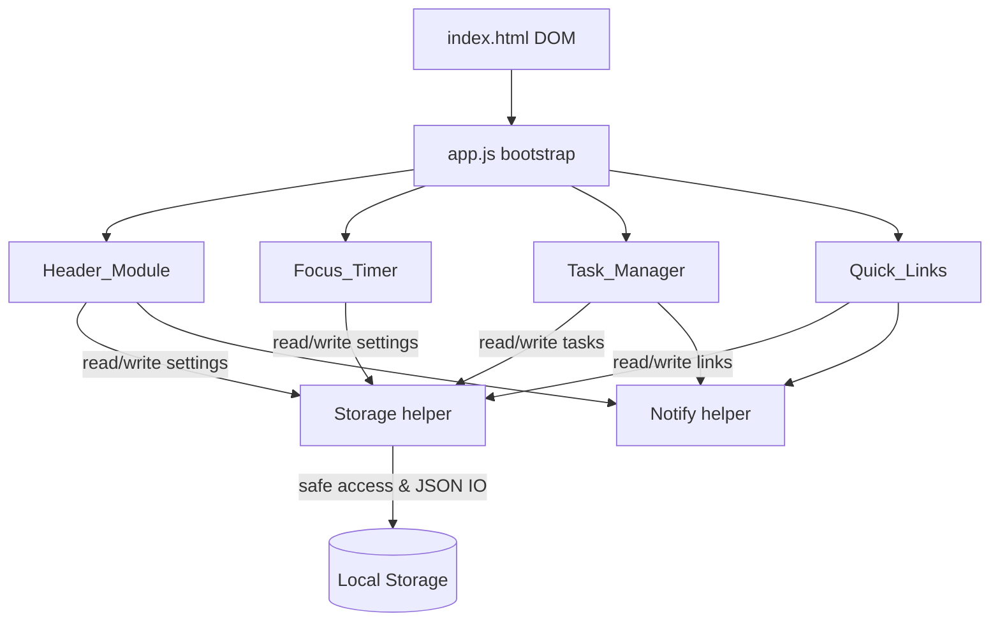
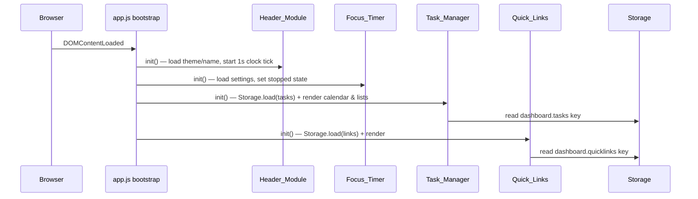
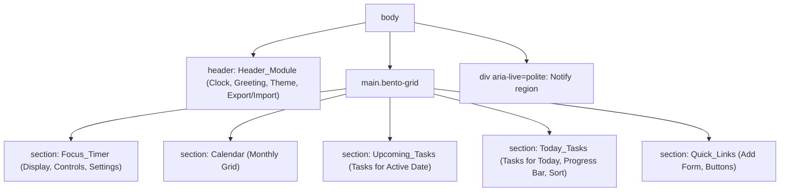

# Design Document

## Overview

The To-Do List Life Dashboard is a fully client-side single-page web application built with HTML, CSS, and vanilla JavaScript. It presents a unified bento-grid dashboard interface combining five primary features: a live clock with an editable custom greeting and theme controls (Header_Module), a customizable focus countdown (Focus_Timer), an interactive calendar with a date-specific task list (Task_Manager), a daily to-do list with progress tracking and drag-and-drop support (Task_Manager), and a set of customizable quick links (Quick_Links). All data persists in the browser's Local Storage so it survives page reloads and browser restarts. There is no backend server; all logic runs in the browser.

The design honors the following user constraints:

- **Stack**: HTML for structure, CSS for styling, vanilla JavaScript only — no frameworks, no build step.
- **Storage**: Browser Local Storage API only; everything is client-side. Data can be exported/imported via JSON.
- **Compatibility**: Modern evergreen browsers (Chrome, Firefox, Edge, Safari).
- **Non-functional**: Clean minimal interface, fast first paint, responsive interactions, clear visual hierarchy, readable typography.
- **Visual Design**: Bento grid layout utilizing a strict color scheme (Background: `#1B1634`, Primary: `#422960`, Secondary: `#01F2FD`, Accents: `#C03F82`, `#C2E3F6`) with solid colors exclusively (no gradients).
- **Folder rules**: Exactly one CSS file in `css/` and exactly one JavaScript file in `js/`.
- **Testing**: No automated test framework or setup is required. Correctness properties are documented to guide manual verification.

### Project File Structure

```
/ (web root)
├── index.html          # Single page: all components in a bento grid
├── css/
│   └── styles.css       # The one and only CSS file
└── js/
    └── app.js           # The one and only JavaScript file (all modules)
```

The single `app.js` file is internally organized into logically separated modules. Keeping everything in one file satisfies the folder rule while still allowing clean, readable separation through an IIFE/module-object pattern.

## Architecture

### High-Level Architecture

The application follows a lightweight **module + view-render** pattern. Each feature is an independent module inside `app.js` with its own in-memory state, its own DOM render function, and its own Local Storage access through a shared Storage helper. Modules share two cross-cutting helpers: `Storage` (safe Local Storage read/write/import/export) and `Notify` (user-facing error/status messages).



### Bootstrap Flow

On `DOMContentLoaded`, the bootstrap routine initializes each module in order. Each module caches its DOM references, loads persisted state (Tasks, Links, and Settings read from Local Storage), performs an initial render, and wires up event listeners.



### Rendering Strategy

The application uses a **render-from-state** approach for the `Task_Manager` and `Quick_Links`: the in-memory array is the single source of truth, and a `render()` function rebuilds the relevant DOM lists from that array after every mutation. The Progress Bar and Calendar grid are dynamically generated based on this state.

### Persistence Strategy

Tasks, Quick Links, and Settings (Theme, Custom Name, Timer Durations) persist. The pattern is **mutate in memory → attempt to persist → on failure, surface an error while keeping the in-memory change visible**. A global JSON Export/Import mechanism allows full round-trip backup of all Local Storage keys.

## Components and Interfaces

### Shared Helper: Storage

Centralizes all Local Storage access and JSON File I/O.

```javascript
Storage.read(key) -> { ok: boolean, value: string|null }
Storage.write(key, value) -> { ok: boolean }
Storage.loadJSON(key) -> { ok: boolean, data: any|null, corrupt: boolean }
Storage.saveJSON(key, data) -> { ok: boolean }
Storage.exportJSON() -> void // Triggers file download of all keys
Storage.importJSON(jsonString) -> { ok: boolean, reason?: string } // Overwrites LS & reloads page
```

### Shared Helper: Notify

Displays transient, accessible status/error messages.

```javascript
Notify.error(message)   // shows an error indication
Notify.info(message)    // shows a status indication
```

### Header_Module

Responsibilities: Live clock display, custom greeting editing, theme toggling, and triggering JSON Import/Export.

```javascript
Header.init()            // load settings, render once, start 1s interval
Header.renderClock()     // read Date, format "Weekday, DD month YYYY | HH:MM:SS"
Header.updateName(name)  // save custom name, re-render greeting
Header.toggleTheme()     // switch Light/Dark mode, persist
```

### Focus_Timer

Responsibilities: Countdown timer with Start, Stop, Reset controls and configurable durations.

```javascript
Timer.init()             // load durations, set state="stopped", render
Timer.start()            
Timer.stop()             
Timer.reset()            // reset remaining to configured duration for current mode
Timer.updateSettings(f, s, l) // validate, save durations to settings, reset timer
Timer.tick()             
Timer.format(sec) -> "MM:SS"
```

### Task_Manager

Responsibilities: Calendar generation, Upcoming Tasks list, Today Tasks list, drag-and-drop operations, duplicate prevention, and progress bar calculation.

```javascript
TaskMgr.init()                   // load from Storage, render calendar & lists
TaskMgr.add(text, targetDate)    // validate, check duplicates, append, persist, render
TaskMgr.edit(id, text)           // validate, replace text, persist, render
TaskMgr.toggle(id)               // flip done, persist, update progress bar
TaskMgr.remove(id)               // delete, persist, render
TaskMgr.handleDrop(id, newDate)  // HTML5 drop handler: mutate date, persist, render
TaskMgr.calculateProgress() -> number // (completedToday / totalToday) * 100
```

### Quick_Links

Responsibilities: Custom link management and rendering.

```javascript
Links.init()                    // load from Storage (or defaults), render
Links.add(label, url)           // validate, append, persist, render
Links.remove(id)                // delete, persist, render
Links.open(id)                  // window.open(url, "_blank", "noopener")
```

## Data Models

### Task

Represents one to-do item.

| Field | Type | Constraints |
|---|---|---|
| id | string | Unique identifier |
| text | string | 1–500 characters after trimming |
| date | string | Format `YYYY-MM-DD` |
| completed | boolean | `true` = done, `false` = not done |

### Quick_Link

Represents one saved favorite site.

| Field | Type | Constraints |
|---|---|---|
| id | string | Unique identifier |
| label | string | 1–50 characters |
| url | string | 1–2048 characters, begins with `http://` or `https://` |

### Local Storage Schema

| Key | Value shape | Written by |
|---|---|---|
| `dashboard.tasks` | `Task[]` | Task_Manager |
| `dashboard.quicklinks` | `Quick_Link[]` | Quick_Links |
| `dashboard.settings` | `Object` (theme, name, timer limits) | Header_Module & Focus_Timer |

## HTML Page Structure

`index.html` uses semantic landmarks organized into a CSS Grid (Bento Layout).



## Correctness Properties

### Property 1: Clock format and Name Customization
*For any* valid Date, the clock formats exactly as `"Weekday, DD month YYYY | HH:MM:SS"`. *For any* custom name update, the greeting reflects the name immediately and persists it without interrupting the clock interval.

### Property 2: Timer Reset
*For any* timer state and *any* custom duration configuration, invoking `reset()` returns the countdown exactly to the user-configured duration of the active mode (Focus, Short Break, or Long Break).

### Property 3: Duplicate Task Prevention
*For any* target date, attempting to add a new task whose trimmed text identically matches an existing task on that *same date* is rejected, leaving the list unchanged.

### Property 4: Drag and Drop Date Mutation
*For any* task dragged from `Upcoming_Tasks` and dropped into `Today_Tasks`, its `date` property mutates to the current date. Dropping a task from `Today_Tasks` into `Upcoming_Tasks` mutates its date to the active calendar date.

### Property 5: Progress Bar Calculation
*For any* list of tasks matching the current date, the progress bar percentage strictly equals `(completed / total) * 100`. If `total` is 0, the percentage is exactly 0.

### Property 6: JSON Export/Import Round-Trip
*For any* valid dashboard state, exporting to JSON and immediately importing that exact JSON file restores the application state entirely and identically (tasks, links, theme, name, timer settings).

## Error Handling

### Invalid JSON Import
If `Storage.importJSON()` encounters an unparseable file or malformed schema, it catches the exception, calls `Notify.error`, and leaves the existing Local Storage entirely unchanged.

### Duplicate Task Rejection
If `TaskMgr.add()` detects a duplicate text for the target date, it aborts the mutation and calls `Notify.error("Task already exists for this date.")`.

### Local Storage Write Failure
`Storage.saveJSON` catches quota/security exceptions. On failure, mutating operations (add, edit, toggle, drop, delete) keep the in-memory/displayed change so the user does not lose visual context, but call `Notify.error("Changes could not be saved.")`.

## Testing Strategy

No automated test framework or test setup is required. Verification is manual.

### Manual Verification Checklist

- **Header & JSON**: Confirm clock format. Edit custom name and verify persistence. Toggle Theme. Export JSON, clear browser data, Import JSON, and verify complete restoration.
- **Focus Timer**: Input custom durations (e.g., 30 min focus, 10 min break). Start, Stop, and Reset. Confirm it resets to 30, not the default 25.
- **Task Manager & Calendar**:
  - Click a future date; verify `Upcoming_Tasks` updates.
  - Add a task to Today. Try adding the exact same task string and verify it is blocked.
  - Edit a task inline. Toggle completion and watch the Progress Bar strictly update.
  - Drag a task from Upcoming and drop it in Today; verify it moves lists and its date property updates.
- **Quick Links**: Add a valid link, verify it opens in a new tab (`_blank`). Attempt to add a link with an empty label and verify rejection.

### Cross-Browser Verification

Manually smoke-test the checklist in Chrome, Firefox, Edge, and Safari to confirm layout integrity of the Bento Grid and responsive behavior.